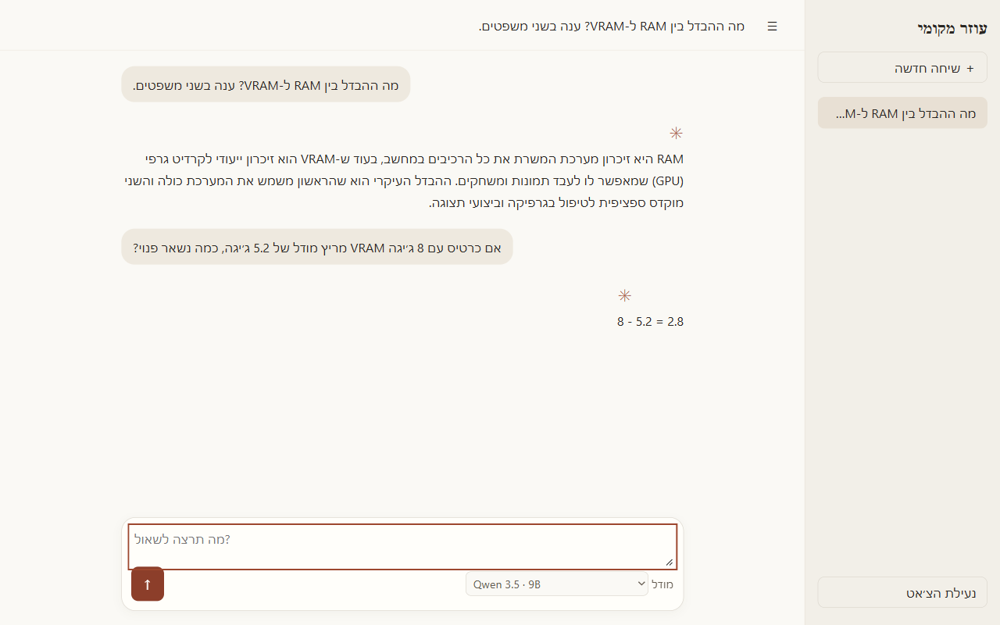

<div align="center">

# Local AI Assistant · עוזר מקומי

**A private ChatGPT-style assistant that runs entirely on a Windows laptop: Hebrew chat UI, a FastAPI backend and open models through Ollama. No subscription, no cloud and no data leaving the machine.**


[](https://github.com/stato10/private-ai-assistant/actions/workflows/tests.yml)

**English** · [עברית](README.he.md)



</div>

## What it does

- **Fully local chat.** FastAPI and Ollama listen on `127.0.0.1` only, Ollama's cloud access is switched off, and the server keeps no conversation history. After setup it works offline.
- **Seven open models, switchable mid-conversation.** Qwen 3.5 (4B and 9B), Gemma 4, NVIDIA Nemotron, Ministral 3 and Liquid AI LFM2.5. The picker lists only the models installed in Ollama; the next reply comes from the chosen model with the recent context.
- **Tool calling.** Qwen 3.5 9B and LFM2.5 can call a local calculator. The chat shows the exact expression the model chose next to the result (`8 - 5.2 = 2.8`), so the user can check it matches the question. The calculator parses with Python's `ast` and exact fractions, and accepts only numbers, `+ - * /` and parentheses.
- **Hebrew-first UI.** Right-to-left layout in plain HTML, CSS and JavaScript, with no framework or build step. Mixed Hebrew and English answers keep their direction.

## Engineering details

| Area | How it's handled |
|---|---|
| **Access** | Every API call needs a random bearer token of 32+ characters, compared in constant time. The PowerShell launcher reads it as a secure string and clears it on exit. |
| **Input limits** | Strict Pydantic models: alternating `user`/`assistant` history ending with the user, at most 9 messages, 1,500 characters each and 2,400 in total. The body is streamed and capped at 24 KB before parsing. |
| **One GPU, one job** | An `asyncio.Lock` allows one generation at a time; a second request gets `429` with `Retry-After` instead of queueing on the GPU. |
| **Failure modes** | Readable error codes: `401`, `413`, `415`, `422`, `429`, `503` (model unavailable) and `504` (timeout). Hidden reasoning blocks are stripped, and truncated replies are rejected rather than shown half-finished. |
| **Browser hardening** | Strict Content Security Policy, `no-store`, `nosniff`, no referrer, trusted-host check and no OpenAPI docs. Tokens and chats live only in page memory, so locking or refreshing clears them. |
| **Swappable provider** | `glassos/provider.py` defines a `ChatProvider` protocol. The UI only talks to the HTTP API, so another backend can be added without touching the chat. |

## Measured on an RTX 4060 laptop (8 GB VRAM)

| Metric | Result |
|---|---|
| Generation speed (Qwen 3.5 4B) | 61–76 tokens/s |
| Response time once the model is loaded | 0.16–1.41 s |
| Peak VRAM | 3.8 GB |
| Basic Hebrew checks (fact, arithmetic, grounding, multi-turn memory) | 8 / 8 |

Full method and numbers in [RESULTS.md](RESULTS.md) (in Hebrew).

## API

| Endpoint | Purpose |
|---|---|
| `GET /healthz` | Liveness |
| `GET /api/v1/session` | Check the access token (`204`) |
| `GET /api/v1/models` | Installed supported models and the default |
| `POST /api/v1/chat` | Model reply plus timing and token counts |

```json
POST /api/v1/chat
Authorization: Bearer <token>

{"model": "qwen3.5:9b-q4_K_M", "messages": [{"role": "user", "content": "What is the difference between RAM and VRAM?"}]}
```

## Run it

Requires Windows, Python 3.12 and [Ollama](https://ollama.com/download/windows) (portable in `.runtime/ollama` or on `PATH`).

```powershell
python -m venv .venv
.\.venv\Scripts\python.exe -m pip install -r requirements-dev.txt

.\scripts\ollama.ps1 serve      # window 1: Ollama, models stored in .runtime/models
.\scripts\ollama.ps1 pull       # once: download the default model
.\scripts\start.ps1             # window 2: asks for your access token, serves http://127.0.0.1:8765
```

Generate a token once with `python -c "import secrets; print(secrets.token_urlsafe(32))"` and keep it in your password manager.

## Tests

```powershell
.\.venv\Scripts\python.exe -m pytest -q   # 31 tests: auth, limits, concurrency, provider contract, calculator
.\.venv\Scripts\python.exe scripts\smoke.py   # end-to-end against the real model, with GPU sampling
```

The unit tests run in CI on every push; the smoke test and benchmark need a local GPU and Ollama.

## Project layout

```
glassos/app.py         FastAPI app: auth, validation, limits, security headers
glassos/provider.py    Ollama provider, model catalogue, tool-call handling
glassos/calculator.py  safe arithmetic tool (AST + fractions)
glassos/web/           chat UI: HTML, CSS, vanilla JS
scripts/               PowerShell launchers, smoke test, benchmark
tests/                 pytest suite
```
